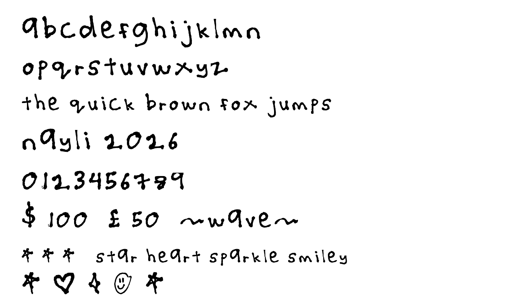
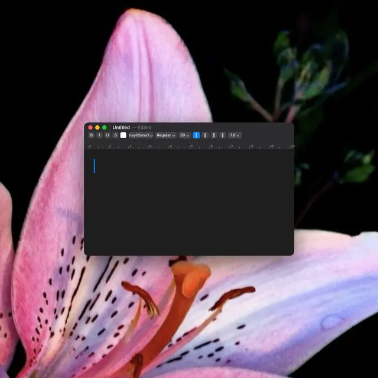

# naylisans





a handwritten font made from a tissue scribble at a cafe. lowercase letters, digits, and a few symbols.

## glyphs

45 glyphs total:
- **a–z** lowercase letters
- **0–9** digits
- **$ £ ~** symbols
- **★ ♥ ✦ ☺** icons (star also on the `*` key)

no capitals, no punctuation. type in lowercase.

## install

**macos:** double-click `fonts/nayliSans1.ttf` → install font  
**windows:** right-click `fonts/nayliSans1.ttf` → install

the font will appear as *naylisans1* in your app's font menu.

## web usage

```css
@font-face {
  font-family: "nayliSans1";
  src: url("fonts/nayliSans1.woff2") format("woff2"),
       url("fonts/nayliSans1.woff")  format("woff");
  font-display: swap;
}

body {
  font-family: "nayliSans1", cursive;
}
```

see `demo/index.html` for a working example.

---

© 2026 nayli c. naza
